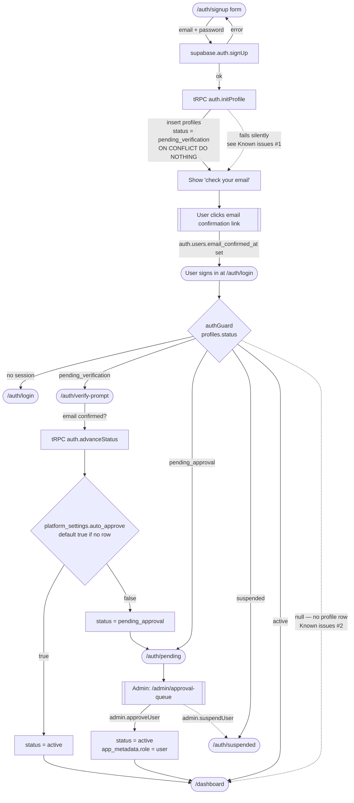
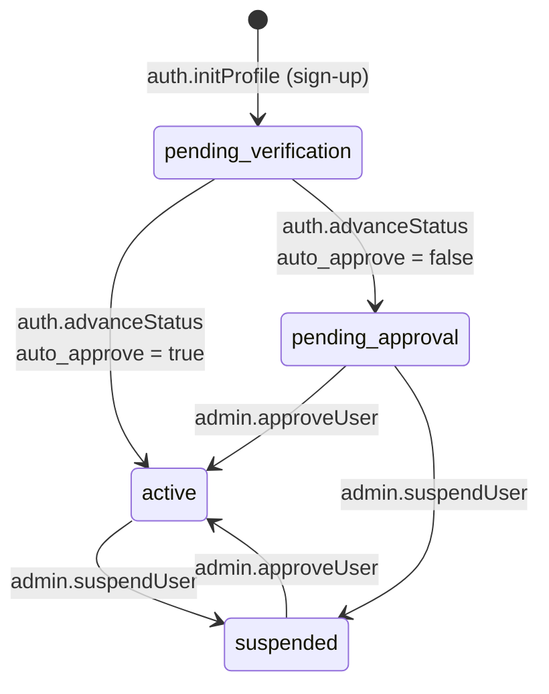
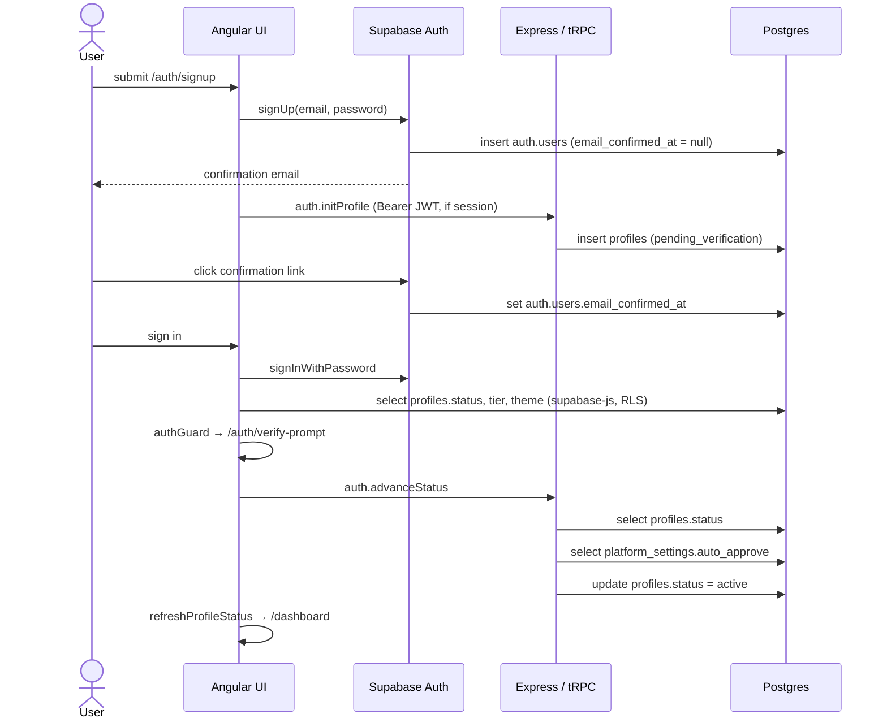

# Sign-up flow & affected tables

Reference doc: how an account goes from sign-up → active user, which code runs at each step, and which tables are read/written.

---

## 1. End-to-end flow

## 2. Profile status lifecycle

## 3. Request sequence (happy path, auto-approve on)

---

## 4. Code map

| Step | Where |
| --- | --- |
| Sign-up form | `ui/src/app/features/auth/signup/signup.ts` |
| Create profile | `api/src/routers/auth.ts` → `initProfile` |
| Profile status load (client) | `ui/src/app/core/services/auth.service.ts` → `loadProfileStatus` (direct supabase-js read of `profiles`) |
| Route gating | `ui/src/app/core/guards/auth.guard.ts`, `admin.guard.ts` |
| Verify → advance | `ui/src/app/features/auth/verify-prompt/verify-prompt.ts` → `auth.advanceStatus` |
| Admin approve / suspend / invite | `api/src/routers/admin.ts` → `approveUser`, `suspendUser`, `inviteUser` |
| Auto-approve setting | `api/src/routers/admin.ts` → `getSettings`, `setAutoApprove` |
| API auth | `api/src/context.ts` (Bearer JWT → user + `app_metadata.role`), `api/src/trpc.ts` (`protectedProcedure`, `adminProcedure`) |

Roles live in **`auth.users.app_metadata.role`** (JWT), not in `profiles.role`. First admin: set `app_metadata: { "role": "admin" }` manually in Supabase dashboard → Authentication → Users.

---

## 5. Affected tables

### Written / read during sign-up & approval

| Table | Column(s) | Written by | Read by |
| --- | --- | --- | --- |
| `auth.users` (Supabase) | `id`, `email`, `email_confirmed_at`, `raw_app_meta_data.role` | `supabase.auth.signUp`, email link, `admin.approveUser` (role = `user`), `admin.inviteUser` | JWT → `AuthService.role`, API `context.ts` |
| `public.profiles` | `id` (= `auth.users.id`), `status`, `tier`, `key_list` | `auth.initProfile` (insert), `auth.advanceStatus`, `admin.approveUser`, `admin.suspendUser` | `AuthService.loadProfileStatus`, `authGuard`, `admin.listUsers` |
| `public.platform_settings` | `auto_approve` (single row; **absent row ⇒ `true`**) | `admin.setAutoApprove` (upsert-style) | `auth.advanceStatus`, `admin.getSettings` |

### `profiles` columns (post-migration `0003`)

| Column | Default | Purpose |
| --- | --- | --- |
| `status` | `pending_verification` | lifecycle above; gates routes |
| `tier` | `basic` | `basic` / `plus` / `pro` — API key policy |
| `key_list` | `default` | global key whitelist / blacklist membership |
| `onboarding` | `null` | jsonb map of completed wizard steps |
| `theme` | `null` | `dark` / `light` persisted preference |
| `biz_name`, `full_name`, `role`, `offering`, `benefits`, `website`, `phone` | `null` | business profile (settings → profile), `role` here = job title, **not** auth role |

### Created later, per user (not during sign-up)

| Table | Keyed by | Created when |
| --- | --- | --- |
| `user_api_keys` | `user_id` | user saves own API keys / SMTP |
| `user_config` | `id` (= user id) | settings → setup (legacy key storage) |
| `leads`, `sent_emails`, `activity_log` | `user_id` | normal app usage |

---

## 6. Known issues

1. **Profile not created when email confirmation is on.** `signUp` returns no session until the email is confirmed → `initProfile` is sent without a Bearer token → `UNAUTHORIZED` → swallowed by `catch {}` in `signup.ts`. User ends up with an `auth.users` row but no `profiles` row.
2. **Missing profile = treated as active.** `authGuard` only redirects on known statuses; `status === null` falls through to `true`. `verify-prompt` / `advanceStatus` also no-op when the row is missing. Combined with #1, approval gating is bypassed. *(2026-11-04: the one existing user had exactly this — profile row backfilled manually as `active`.)*
3. **Invited users get no profile.** `admin.inviteUser` only calls `inviteUserByEmail`; nothing inserts `profiles`.
4. **"Resend verification" sends a password-reset email.** `verify-prompt.ts` → `resendVerification` calls `auth.resetPassword`; should be `supabase.auth.resend({ type: 'signup', email })`.

Suggested fix for 1–3: create the profile server-side — Postgres trigger on `auth.users` insert (`insert into public.profiles (id) values (new.id) on conflict do nothing`), or call `initProfile` lazily on first authenticated load when the profile is missing — and make `authGuard` treat `null` as `pending_verification`.

## 7. Migrations

Schema is managed by drizzle (`api/drizzle/`). Render does **not** run migrations — run `cd api && npm run db:migrate` after schema changes. Production DB was baselined on 2026-11-04 (`0000` marked applied, `0001`–`0003` applied).
